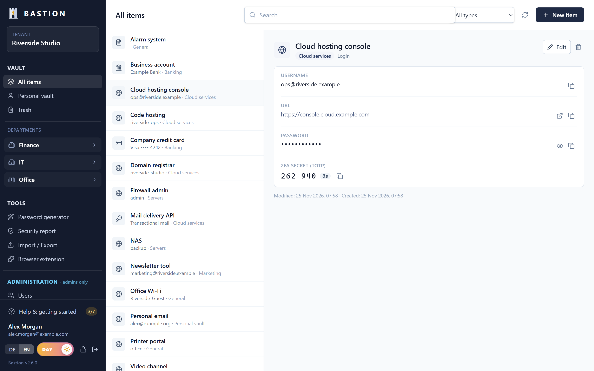
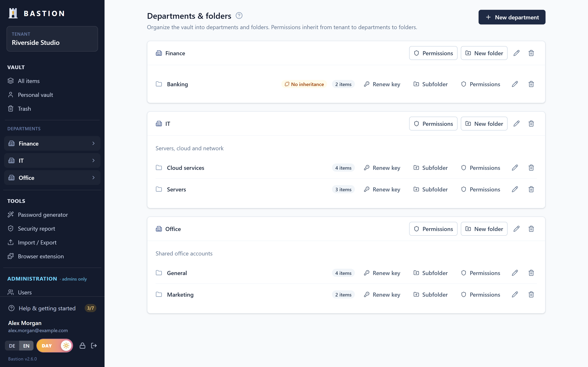
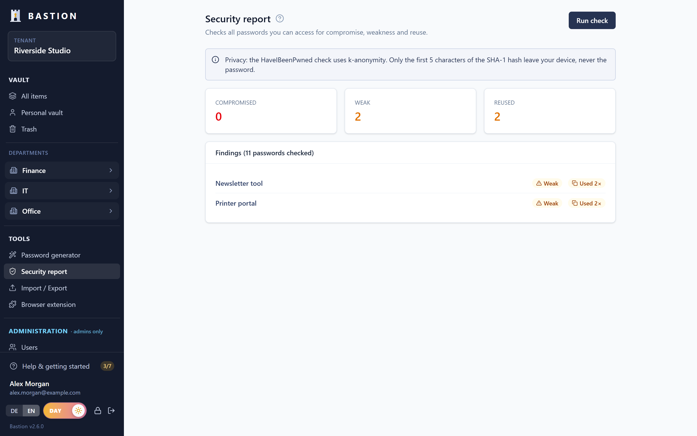

<p align="center"></p>

<p align="center"><b>Ihre Schlüssel. Ihre Festung.</b><br>Ein selbst gehosteter Passwort-Tresor mit Zero-Knowledge-Architektur, für Teams, Familien und dich selbst.</p>

<p align="center"><a href="README.md">English</a> · <a href="docs/OPERATIONS.de.md">Betriebsanleitung</a> · <a href="docs/SECURITY.md">Sicherheitskonzept</a> · <a href="https://github.com/ccbusse/bastion/releases">Releases</a></p>



Alle Einträge werden im Browser verschlüsselt. Der Server sieht weder Passwörter noch Masterpasswörter.

* **Für Unternehmen:** Abteilungen und Ordner, fein abgestufte Rollen, Einladungen mit Fingerprint-Abgleich, Audit-Log mit Hash-Kette, Kontowiederherstellung durch Admins.
* **Privat:** gemeinsame Ordner für den Haushalt, ein persönlicher Tresor für jede Person, Zwei-Faktor-Anmeldung, Browser-Erweiterung.
* **Backups:** tägliches verschlüsseltes Datenbank-Backup und ein Notfall-Backup, das sich offline ohne Bastion öffnen lässt.
* **Einfach zu betreiben:** ein Docker-Compose-Stack mit automatischem TLS. Oberfläche auf Deutsch und Englisch.

| Abteilungen & Ordner | Sicherheitsbericht |
|---|---|
|  |  |

## Installation

Du brauchst einen Linux-Server mit Docker und Compose v2.

```bash
curl -fsSL https://github.com/ccbusse/bastion/releases/latest/download/install.sh | bash
```

Das Skript lädt die aktuelle Version, fragt nach deiner Domain, erzeugt alle Geheimnisse und startet Bastion. Danach die angezeigte Einrichtungsadresse öffnen und das eigene Masterpasswort festlegen.

Installation von Hand, Signaturprüfung der Images, Betrieb hinter einem Reverse Proxy, Aktualisierung und Backups: siehe **[Betriebsanleitung](docs/OPERATIONS.de.md)**.

## Aktualisieren

Zuerst das [Changelog](CHANGELOG.md) lesen, dann:

```bash
docker compose exec backup bastion-backup now   # vorher sichern
# BASTION_VERSION in .env auf die neue Version setzen
docker compose pull && docker compose up -d
```

## Mehr

* [Betriebsanleitung](docs/OPERATIONS.de.md): Installation im Detail, Aktualisieren, Datenbank- und Notfall-Backup, Rechtemodell, Browser-Erweiterung
* [Entwicklung](docs/DEVELOPMENT.de.md): Architektur, aus dem Quellcode bauen, Releases
* [Mitwirken](CONTRIBUTING.md) (Englisch)
* [Sicherheitskonzept](docs/SECURITY.md). Schwachstellen bitte vertraulich über [Security → Report a vulnerability](https://github.com/ccbusse/bastion/security/advisories/new) melden, nicht in öffentlichen Issues.

## Lizenz

[AGPL-3.0-or-later](LICENSE). Wer eine veränderte Version anderen über ein Netzwerk anbietet, muss ihnen auch deren Quellcode zugänglich machen.
