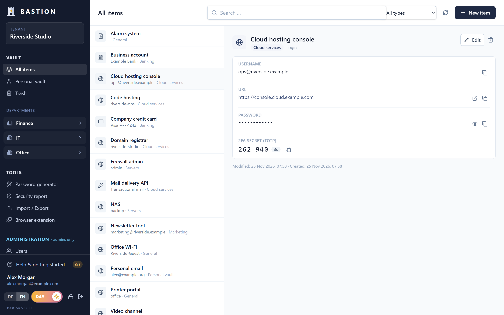
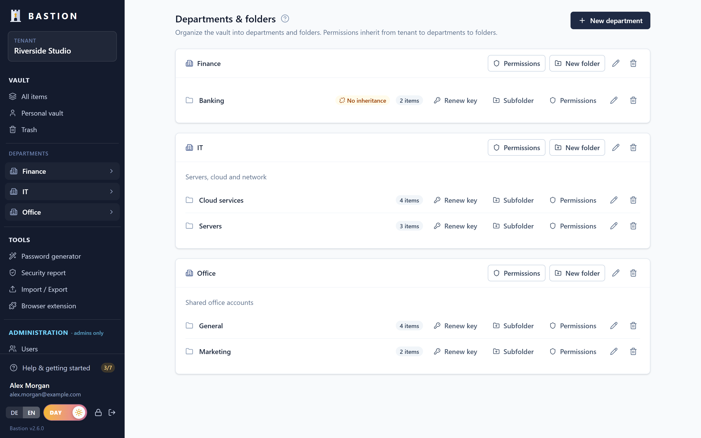
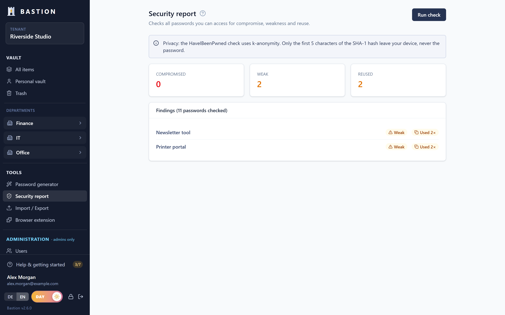

<p align="center"></p>

<p align="center"><b>Your keys. Your fortress.</b><br>A self-hosted, zero-knowledge password vault for teams, families and yourself.</p>

<p align="center"><a href="README.de.md">Deutsch</a> · <a href="docs/OPERATIONS.md">Operating guide</a> · <a href="docs/SECURITY.md">Security concept</a> · <a href="https://github.com/ccbusse/bastion/releases">Releases</a></p>



Every item is encrypted in your browser. The server never sees passwords or master passwords.

* **For businesses:** departments and folders, fine-grained roles, invitations with fingerprint check, audit log with hash chain, account recovery by admins.
* **For private use:** shared folders for the household, a personal vault for everyone, two-factor sign-in, browser extension.
* **Backups:** daily encrypted database backup, plus an emergency backup that opens offline without Bastion.
* **Easy to run:** one Docker Compose stack with automatic TLS. German and English UI.

| Departments & folders | Security report |
|---|---|
|  |  |

## Installation

You need a Linux server with Docker and Compose v2.

```bash
curl -fsSL https://github.com/ccbusse/bastion/releases/latest/download/install.sh | bash
```

The script downloads the current release, asks for your domain, generates all secrets and starts Bastion. Then open the setup address it shows and choose your master password.

Manual installation, image signatures, running behind a reverse proxy, updates and backups: see the **[operating guide](docs/OPERATIONS.md)**.

## Updating

Read the [changelog](CHANGELOG.md) first, then:

```bash
docker compose exec backup bastion-backup now   # backup first
# set BASTION_VERSION in .env to the new version
docker compose pull && docker compose up -d
```

## More

* [Operating guide](docs/OPERATIONS.md): installation details, updates, database and emergency backup, permission model, browser extension
* [Development](docs/DEVELOPMENT.md): architecture, building from source, releases
* [Contributing](CONTRIBUTING.md)
* [Security concept](docs/SECURITY.md) (German). Report vulnerabilities privately via [Security → Report a vulnerability](https://github.com/ccbusse/bastion/security/advisories/new), not in public issues.

## License

[AGPL-3.0-or-later](LICENSE). If you offer a modified version to others over a network, you must make its source code available to them.
